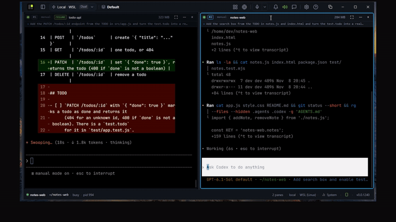

# SoluTerminal

A focused workspace for Claude Code and Codex on Windows. Run them side by side in PowerShell and WSL panes,
keep them running when you close the window, and stay in charge of what they can approve.


<sub>The real app, sped up and trimmed.</sub>

**On Windows?** Get the app from [soluterminal.com](https://soluterminal.com/download/?utm_source=github&utm_campaign=oss-launch) (free during beta).
[Help](https://soluterminal.com/help/?utm_source=github&utm_campaign=oss-launch) · [Security](https://soluterminal.com/security/?utm_source=github&utm_campaign=oss-launch) ·
[Privacy](https://soluterminal.com/privacy/?utm_source=github&utm_campaign=oss-launch)

## What it does
- **Agents can ask each other.** Claude Code and Codex in SoluTerminal's panes get local tools to read, message and
  start panes, so one agent can ask another for a second opinion and you watch both.
- **Agents can't approve themselves.** Agents using SoluTerminal's tools can't approve their own requests or turn
  on auto-approve unless you allow it for a while.
- **You're pulled in only when it matters.** The pane waiting for your decision is flagged; answer with one click.
- **Work keeps going.** Sessions keep running when you close the window, and Claude Code and Codex conversations
  can be picked up again after a restart.
- **Auto-approve, per pane:** Off (the default), Approve with caution, or Always approve.
- **Your tools, unchanged.** Your own Claude Code or Codex login, and any other command-line agent runs in a pane
  too. In the Windows app, Windows PowerShell and Linux (WSL) panes sit side by side.

The official Windows app can also connect to an optional free account for phone-browser access, push alerts,
voice input and smart approvals. The app's side of that is in this repository; the hosted service itself isn't.

## What's in this repository
- `daemon/`: the local background service that owns every session, including pane-to-pane communication.
- `web/`: the app's interface.
- `shared/`: shared libraries and the wire protocol.
- `desktop/`: the Windows desktop shell ([desktop guide](desktop/README.md)).

Not included: the hosted service itself (relay, accounts, push alerts), some internal tools and our signing and
publishing scripts. Builds from this repository are set up for our hosted service, like the official app; the
[desktop guide](desktop/README.md#hosted-cloud) shows how to build without it. Builds you make yourself report
version dev and send no check-in.

## Build from source
Needs Node 20 or later and Go 1.26 (the version in `daemon/go.mod`). From the top of the repository:

```sh
cd web && npm ci && npm run build && cd ..
rm -rf daemon/webdist && cp -r web/dist daemon/webdist
cd daemon && go build -o solud . && ./solud
```

Then open the address it prints (`http://127.0.0.1:8787/` by default). The background service builds for Linux and
Windows. It also compiles for macOS, untested there. The desktop shell builds separately; see the
[desktop guide](desktop/README.md).

## Optional configuration
Smart approvals ("Approve with caution") can use an AI check on a pane's permission prompt. A build from this
repository gets it in either of two ways:
- connect the daemon to a free account for the hosted allowance: pair once with
  `solud --claim --relay wss://soluterminal-cloud.onrender.com/relay`, then always start it with that `--relay`.
  Each check sends the prompt's visible text to our hosted service;
- or set your own `TYPESAFE_API_KEY` in the daemon's environment. Each check sends the prompt's visible text to
  TypeSafe and is billed to your key. Change the key by restarting the daemon.

With neither, every prompt is left for you.

## Security
- Updates for the official app are signed, and the app checks the signature before installing.
- From version 0.0.1225, the official Windows installer is built from this repository by its public GitHub Actions
  workflow (`official-build.yml`, see [official build](docs/OFFICIAL-BUILD.md)) from a tagged commit. The background
  service is built twice on separate runners and must match byte for byte, and every file is published with its
  SHA-256 and a GitHub build attestation. We check those before signing the update manifest with a key that never
  leaves our side. The installer isn't code-signed by Windows yet. (A build you make yourself from this README reports
  version dev, so it won't match a release byte for byte.)
- What's on by default and the known limits: [soluterminal.com/security](https://soluterminal.com/security/?utm_source=github&utm_campaign=oss-launch).
- [Code signing policy](docs/CODE-SIGNING.md): eligible Windows builds, release roles and signature checks.
- Found a vulnerability? Report it privately through GitHub's "Report a vulnerability" or email
  security@soluterminal.com. See [SECURITY.md](SECURITY.md).

## Contributing
Issues and pull requests are welcome. Start with [CONTRIBUTING.md](CONTRIBUTING.md) and the
[good first issues](https://github.com/soluterminal/soluterminal/issues?q=is%3Aopen+label%3A%22good+first+issue%22).
Questions and ideas go in [Discussions](https://github.com/soluterminal/soluterminal/discussions).

## License
SoluTerminal is licensed under the Apache License 2.0 ([LICENSE](LICENSE)).

## Status
Beta. The app is Windows only for now; add a 👍 to
[the macOS and Linux issue](https://github.com/soluterminal/soluterminal/issues?q=is%3Aissue+label%3Aplatform%3Amacos) if you'd use a macOS
or Linux app.
